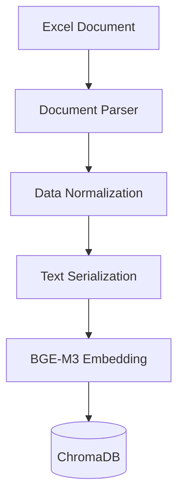
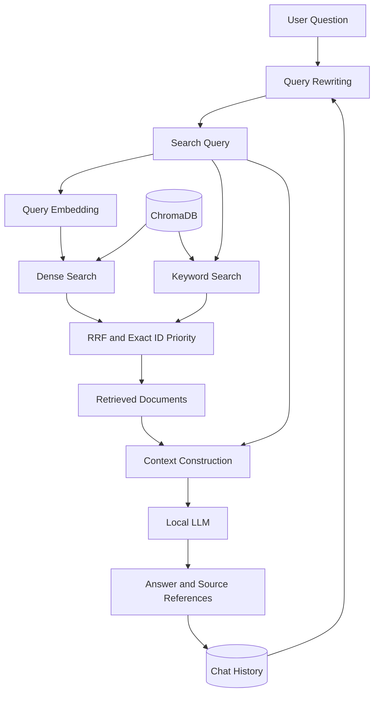
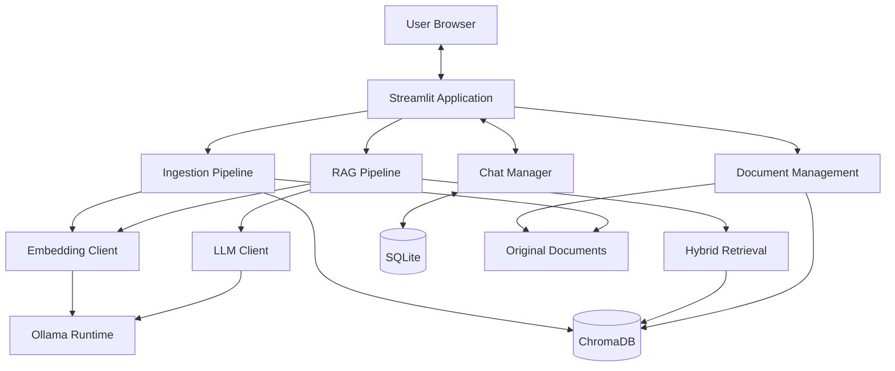

# Local Document Intelligence — Developer Overview

- 기준 버전: v0.1.0
- 기준 Commit: 3b70615
- 개발 상태: MVP / Local Prototype

## 1. 프로젝트 개요

Local Document Intelligence는 회사 내부 문서를 기반으로
자연어 검색, 질의응답 및 정보 분석을 수행하기 위한
로컬 AI 애플리케이션이다.

첫 번째 적용 대상으로 차량 A/S 정비 이력을 선정하였다.

사용자는 기존 정비 기록을 직접 찾아보는 대신
자연어 질문을 통해 고장 증상, 발생 원인, 조치 내용,
교체 부품 등의 정보를 확인할 수 있다.

장기적으로는 A/S 정비 기록뿐만 아니라 다양한 사내 문서를
활용할 수 있는 범용 Document Intelligence 시스템을 목표로 한다.

## 2. 개발 목적

- 사내 문서에 대한 자연어 검색 및 질의응답
- 기존 정비 사례 검색 및 비교 분석
- 반복적인 고장 유형과 조치 사례 확인
- AI 답변에 대한 원본 문서 추적
- 외부 생성형 AI API에 의존하지 않는 로컬 추론
- 향후 사내 지식 관리 시스템으로 확장

## 3. 개발 접근 방식

초기에는 Ollama와 Open WebUI를 활용하여
Local LLM 및 RAG의 기본 동작을 검증하였다.

이후 범용 문서 처리 과정에서 발생하는 불필요한 데이터,
검색 품질 및 Context Window 문제를 개선하고
RAG 내부 구조를 직접 제어하기 위해 Python 기반의
독립적인 애플리케이션을 구현하였다.

LangChain, LlamaIndex 등의 RAG 프레임워크에 의존하지 않고
문서 처리, Embedding, 검색, 프롬프트 구성 및 LLM 연동의
핵심 로직을 직접 구현하였다.

현재 자체 애플리케이션은 Open WebUI 없이 실행 가능하다.

## 4. 핵심 AI 기술

### 4.1 Local LLM

Ollama를 통해 로컬 환경에서 생성형 AI 모델을 실행한다.

기본 생성 모델은 qwen3.5:4b-q4_K_M이다.

LLM은 검색된 정비 기록을 바탕으로 자연어 답변을 생성하며,
이전 대화를 활용한 검색 질문 재구성에도 사용된다.

### 4.2 RAG

RAG(Retrieval-Augmented Generation)는 사용자 질문과
관련된 문서를 검색하고, 해당 문서를 LLM에 제공하여
답변을 생성하는 기술이다.

모델의 가중치를 재학습하는 Fine-tuning과 달리
기존 모델을 유지하면서 새로운 문서를 검색 대상으로
추가하거나 갱신할 수 있다.

### 4.3 Text Embedding

Embedding은 텍스트를 수치 벡터로 변환하는 과정이다.

본 시스템은 BGE-M3 모델을 사용하여 문서와 질문을
1024차원의 벡터로 변환한다.

문서와 질문의 벡터를 비교하여 의미적으로 관련된
정비 기록을 검색한다.

### 4.4 Hybrid Search

의미 기반 검색과 키워드 기반 검색을 결합한다.

- Dense Search: 코사인 유사도 기반 벡터 검색
- Keyword Search: 문자열 및 키워드 일치 기반 검색
- RRF: Reciprocal Rank Fusion을 통한 검색 순위 결합
- Exact ID Match: 정확한 문서번호 일치 시 우선순위 적용

현재 Keyword Search는 단순 문자열 일치 방식이며,
BM25 및 전용 Reranker는 적용하지 않았다.

문서번호 일치는 검색 순위를 높이는 방식이며,
해당 문서만 반환하도록 강제하는 필터는 아니다.

### 4.5 Conversational RAG

이전 대화를 활용하여 후속 질문의 문맥을 파악한다.

예시:

- 첫 번째 질문: 테스트 차량 1호의 고장 원인이 무엇인가?
- 후속 질문: 그러면 어떤 부품을 교체했는가?
- 재구성 질문: 테스트 차량 1호의 정비 과정에서
  교체한 부품은 무엇인가?

재구성된 질문을 기반으로 관련 문서를 다시 검색한다.

### 4.6 Source Reference

검색된 문서의 문서번호, 파일명, 시트명 및
원본 셀 위치 정보를 관리한다.

사용자는 AI 답변에 표시된 참조 문서를 확인하고
원본 Excel 파일을 다운로드할 수 있다.

참조 문서 표시는 답변의 정확성을 자동으로
보증하는 기능은 아니다.

## 5. 시스템 아키텍처

### 5.1 Document Ingestion Pipeline

1. Excel 원본에서 실제 정비 기록 시트를 선택한다.
2. 필요한 셀 데이터를 추출한다.
3. 정비 정보를 19개 표준 필드로 구조화한다.
4. 구조화된 데이터를 검색용 텍스트로 변환한다.
5. BGE-M3를 통해 Embedding 벡터를 생성한다.
6. 벡터, 텍스트 및 원본 출처를 ChromaDB에 저장한다.

현재는 A/S 일지 한 건을 하나의 검색 단위로 관리한다.

PDF Parser는 별도로 구현되어 있지만
PDF 데이터의 정규화 및 검색 등록은 아직 지원하지 않는다.

### 5.2 Question Answering Pipeline

첫 질문은 Query Rewriting을 생략하며,
후속 질문에서는 최근 대화 내용을 활용한다.

검색 결과 중 기본적으로 최대 3건의 문서를
LLM의 답변 생성 컨텍스트로 제공한다.

### 5.3 Application Architecture

ChromaDB는 정비 지식을 검색하기 위한 저장소이며,
SQLite는 사용자 채팅 이력을 관리하기 위한 저장소이다.

두 데이터베이스는 독립적으로 관리한다.

## 6. Technology Stack

| Layer | Technology | Purpose |
|---|---|---|
| Development OS | WSL2 Ubuntu | Linux 기반 개발 환경 |
| Language | Python 3.12.16 | 애플리케이션 개발 |
| Package Manager | uv | 의존성 및 가상환경 관리 |
| LLM Runtime | Ollama | 로컬 AI 모델 실행 |
| Generation Model | Qwen3.5 4B Q4_K_M | 자연어 답변 생성 |
| Embedding Model | BGE-M3 | 의미 기반 벡터 생성 |
| Vector Database | ChromaDB | 벡터 저장 및 검색 |
| Relational Database | SQLite | 채팅 이력 저장 |
| Excel Parser | openpyxl | Excel 셀 데이터 추출 |
| PDF Parser | pypdf | PDF 텍스트 추출 |
| Retrieval | Dense, Keyword, RRF | 관련 문서 검색 |
| Web Framework | Streamlit | 웹 사용자 인터페이스 |
| Version Control | Git, GitHub | 소스 및 버전 관리 |

## 7. 주요 기술 선정 근거

### Ollama

로컬 AI 모델을 REST API로 실행하고 관리할 수 있다.
애플리케이션과 모델 실행 환경을 분리할 수 있으며,
생성 모델 변경에 따른 애플리케이션 수정 범위를 줄인다.

### Qwen3.5 4B

초기 개발 환경인 8GB VRAM GPU에서 로컬 추론을
수행할 수 있는 모델로 선정하였다.

다른 모델 대비 성능 우위가 검증된 것은 아니며,
향후 모델별 답변 정확도 및 속도 비교가 필요하다.

### BGE-M3

한국어를 포함한 다국어 텍스트의 의미 기반 검색을
지원하는 Embedding 모델로 선정하였다.

현재 구현에서는 BGE-M3의 Dense Embedding을 사용한다.

### ChromaDB

별도의 데이터베이스 서버 없이 로컬 환경에서
벡터 데이터를 저장하고 검색할 수 있다.

초기 소규모 RAG 애플리케이션 구현에 적합하다.

### SQLite

채팅방, 질문, 답변 및 참조 문서를
별도의 데이터베이스 서버 없이 저장할 수 있다.

### Streamlit

Frontend와 Backend를 별도로 개발하지 않고
Python 기반으로 웹 인터페이스를 빠르게 구현할 수 있다.

현재는 기술 검증 및 프로토타입 개발을 우선하며,
실제 서비스 운영 시 웹 아키텍처 변경을 검토한다.

## 8. 프로젝트 모듈 구성

| Module | Responsibility |
|---|---|
| app.py | 웹 사용자 인터페이스 |
| chat_store.py | SQLite 채팅 이력 관리 |
| parsers/ | Excel 및 PDF 데이터 추출 |
| preprocessors/ | 정비 데이터 구조화 |
| embeddings/ | 텍스트 변환 및 벡터 생성 |
| vector_store/ | 벡터 DB 및 문서 관리 |
| retrieval/ | Dense Search 및 Hybrid Search |
| llm/ | Ollama API 및 모델 설정 |
| rag/ | RAG 및 Conversational RAG |
| ingestion/ | 자동 문서 등록 |
| config/ | 실행 환경 설정 |
| scripts/ | 환경 실행 스크립트 |
| docs/ | 프로젝트 문서 |
| storage/ | 로컬 실행 및 데이터 저장 |

상세 모듈 구성은 architecture.md를 참고한다.

## 9. 주요 설계 원칙

- 문서 처리, 검색, 답변 생성 및 UI의 역할 분리
- Embedding 모델과 생성 모델의 독립적인 구성
- 원본 데이터와 검색용 데이터의 분리
- 원본 문서 및 데이터 출처 보존
- 기존 기능의 재사용과 모듈 단위 확장
- 실제 회사 데이터와 소스 코드의 분리 관리
- 특정 외부 생성형 AI API에 의존하지 않는 구조

생성 모델만 변경할 경우 기존 Embedding 및
Vector Database를 재사용할 수 있다.

Embedding 모델이 변경될 경우에는 기존 문서의
재Embedding 및 검색 인덱스 재구성이 필요하다.

## 10. 현재 구현 및 검증 상태

| Feature | Status |
|---|---|
| Local LLM Inference | 기본 동작 확인 |
| Excel Parsing | 기본 동작 확인 |
| PDF Text Extraction | 기본 동작 확인 |
| Data Normalization | 특정 양식 지원 |
| Text Embedding | 기본 동작 확인 |
| Persistent Vector Database | 기본 동작 확인 |
| Dense Search | 기본 동작 확인 |
| Hybrid Search | 기본 동작 확인 |
| Traditional RAG | 기본 동작 확인 |
| Conversational RAG | 기본 동작 확인 |
| Multi-document Question Answering | 기본 동작 확인 |
| Excel Upload | 기본 동작 확인 |
| Batch Document Upload | 구현 완료, 성공 경로 추가 검증 필요 |
| Document Management | 구현 완료, 삭제 동작 추가 검증 필요 |
| Original File Download | 기본 동작 확인 |
| Persistent Chat History | 구현 완료, 세부 동작 추가 검증 필요 |
| Configurable LLM | 구현 완료, 실제 모델 교체 미검증 |

전체 기능에 대한 독립적인 통합 QA 및
정량적 정확도 검증은 아직 완료되지 않았다.

## 11. 초기 개발 환경 및 관측 성능

### Development Hardware

| Component | Specification |
|---|---|
| CPU | AMD Ryzen 9 8945HS |
| RAM | 32GB |
| GPU | NVIDIA RTX 4060 Laptop |
| VRAM | 8GB |
| OS | Windows / WSL2 Ubuntu 26.04 LTS |

### Default Inference Configuration

| Parameter | Value |
|---|---|
| Generation Model | qwen3.5:4b-q4_K_M |
| Embedding Model | bge-m3:567m |
| Context Window | 16384 |
| Thinking | Disabled |
| Temperature | 0.1 |
| Max Output Tokens | 1024 |
| Retrieval Top-K | 3 |

### Observed Response Time

| Scenario | Response Time |
|---|---:|
| 단일 문서 질의응답 | 2.09초 |
| 대화 문맥 기반 후속 질문 | 2.60초 |
| 정비 조치 내용 조회 | 4.14초 |
| 두 차량의 정비 이력 비교 | 17.54초 |

위 수치는 개발 과정에서 관측한 개별 실행 결과이다.

동일한 조건의 반복 벤치마크 결과가 아니며,
모델 성능이나 시스템 처리량을 보증하지 않는다.

## 12. 현재 기술적 한계

### Document Processing

- A/S Excel 일지의 양식이 일관되지 않음
- 고정 셀 매핑 방식의 전처리
- 지원하지 않는 문서 양식의 등록 제한
- PDF 정규화 및 검색 연동 미구현
- OCR 및 이미지 분석 미구현

### Retrieval and Generation

- 소규모 문서 집합에 최적화된 검색 구조
- 검색 관련성 임계값 미적용
- BM25 및 Reranking 미적용
- 답변 정확도 및 인용 정확도 자동 검증 미구현
- LLM Hallucination 발생 가능성
- 전체 건수 및 통계 분석의 완전성 미보장

### Application and Security

- 단일 사용자 로컬 환경 기준
- 사용자 인증 및 권한 관리 미구현
- 문서 개정 이력 관리 미구현
- 등록 실패 시 완전한 롤백 미구현
- 감사 로그 및 운영 백업 체계 미구현
- 완전한 오프라인 동작 및 네트워크 통신 미검증

## 13. 데이터 보안 및 관리

원본 문서, 검색용 데이터, Embedding 벡터,
Vector Database 및 채팅 이력은 storage/에 저장한다.

storage/는 Git 관리 대상에서 제외한다.

- 실제 회사 문서 및 개인정보는 GitHub에 등록하지 않는다.
- 개발 및 QA에는 합성 테스트 데이터를 우선 사용한다.
- Ollama 및 Streamlit은 기본적으로 Loopback 주소를 사용한다.
- Ollama Cloud 기능 비활성화 설정을 적용한다.

단, 로컬 실행 설정만으로 모든 외부 네트워크 통신이
차단되었다고 판단해서는 안 된다.

보안 검증 이전에는 승인되지 않은 기밀 문서 처리 및
실제 사내 운영 환경 배포를 진행하지 않는다.

## 14. 향후 개발 방향

### Document Intelligence

- 다양한 문서 양식 지원
- 항목명 기반 동적 데이터 추출
- Rule-based 및 LLM-based Hybrid 전처리
- PDF 검색 연동 및 OCR
- 문서 처리 정확도 검증

### Retrieval and AI

- BM25 및 고급 Keyword Search
- Metadata Filtering
- Reranking
- 검색 및 답변 정확도 정량 평가
- 모델별 품질 및 응답 속도 비교

### Application

- UI/UX 개선
- Streaming 응답
- 문서 개정 관리
- 등록 오류 처리 개선

### Production Readiness

- 사용자 인증 및 RBAC
- Audit Log
- 백업 및 복구
- 데이터 보존 정책
- 외부 통신 및 보안 검증
- 사내 서버 배포 구조 검토

상세 개발 계획은 roadmap.md에서 관리한다.

## 15. 결론

Local Document Intelligence v0.1.0은
문서 처리, Embedding, Hybrid Search, Local LLM,
Conversational RAG 및 웹 인터페이스를 통합한
Python 기반 로컬 AI 프로토타입이다.

현재 차량 A/S 정비 기록을 활용한 기본 RAG 기능을
구현하였으며, 향후 범용 사내 문서 활용 시스템으로
확장할 수 있도록 모듈 단위로 구성하였다.

다양한 문서 양식 대응, 전체 기능 검증,
검색 및 답변 신뢰성 평가, 보안 검증은
실제 사내 적용 이전에 완료해야 한다.

## Related Documents

- [Project README](../README.md)
- [System Architecture](architecture.md)
- [Developer Setup Guide](developer-setup.md)
- [Local LLM Validation](archive/local-llm-validation.md)
- [Initial RAG PoC Validation](archive/rag-poc-validation.md)
- [Development Roadmap](roadmap.md)
